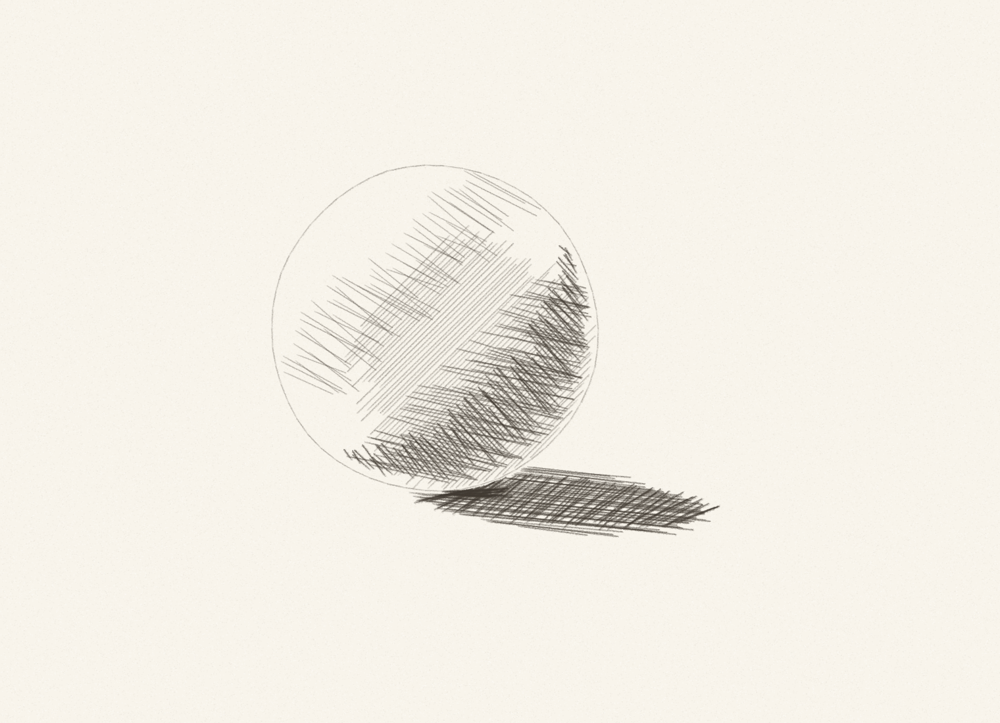

# Selvedge CUA MCP

Selvedge runs computer-use scripts against the macOS desktop. It exposes one
MCP tool, `run({code})`, over stdio. Each call runs an async JavaScript function
body in embedded QuickJS and returns JSON and any captured PNGs.

## Plaster sphere sketch comparison

Both runs were routed to GPT-6.2-Sol with medium reasoning effort.

| | Selvedge | Codex Computer Use |
| --- | --- | --- |
| Exported sketch |  |  |
| End-to-end time | 4 min 34.5 s | 7 min 8.8 s |
| Computer Use call time (sum) | 16.9 s | 229.7 s |
| Total tokens (including cached input) | 1,337,595 | 2,258,485 |
| Uncached input tokens | 53,268 | 111,812 |
| Output tokens (including reasoning) | 6,375 | 5,105 |

## Build and run

Build on macOS with Xcode Command Line Tools, Rust, and the Rocq 9.2 toolchain
used to build [Rocq2Rust](https://github.com/OpenSourceVerif/Rocq2Rust). Follow
the compiler's installation instructions, including its MetaRocq overlay, and
run `make build` in the compiler checkout. The Cargo build expects a sibling
`rocq2rust` checkout by default. For a different location:

```sh
export ROCQ2RUST_PLUGIN=/absolute/path/to/rocq2rust/_build/rocq2rust-plugin
cargo build --release --locked
platform/macos/package-app.sh target/release/selvedge-cua-mcp \
  'target/release/Selvedge CUA MCP.app'
```

Configure the MCP client to launch the absolute executable path printed by
the packaging script over stdio:

```toml
[mcp_servers.selvedge-cua-mcp]
command = "/absolute/path/to/target/release/Selvedge CUA MCP.app/Contents/MacOS/selvedge-cua-mcp"
```

Each Codex chat can start a separate MCP process. Launch the executable
inside `Contents/MacOS` so that ScreenCaptureKit can serve multiple processes
from the same install. Concurrent processes launched from the same bare
executable can cause screenshot timeouts. Reconnect the MCP client after
changing its configuration or replacing the bundle.

The package is ad hoc signed for local use by default. Set
`SELVEDGE_CODESIGN_IDENTITY` to an existing Developer ID Application identity
to sign with hardened runtime for [Locked Use](platform/locked-use/README.md).
Selvedge uses macOS 14 or later and the host application's Screen Recording
and Accessibility permissions. JavaScript is embedded, and Rocq is only
needed at build time.

### Select Selvedge from Codex's @ menu

Install the local Codex plugin to select **Selvedge** from the chat composer's
@ menu. The plugin registers the same stdio MCP server and launches the
executable inside the app bundle.

```sh
python3 platform/codex/package-plugin.py \
  'target/release/Selvedge CUA MCP.app' target/release/selvedge-codex-marketplace
codex plugin marketplace add "$PWD/target/release/selvedge-codex-marketplace"
codex plugin add selvedge@selvedge-local
```

When migrating from the direct MCP configuration above, run
`codex mcp remove selvedge-cua-mcp` after installing the plugin so the
plugin owns the server registration. Reopen the desktop app to refresh
the plugin list, then type `@Selvedge` in a local Codex chat.

## Write a script

A script can return any JSON-serializable value. Native calls return promises
and report errors as rejections. This example finds a Chrome drawing board
without changing the foreground app.

```js
const { windows } = await listWindows({ bundleId: "com.google.Chrome" });
const boards = windows.filter(window => window.title?.startsWith("石墨画板"));
if (boards.length !== 1) throw new Error("Select one drawing board");
const { windowId } = boards[0];
const ui = await readUI({ windowId });
if (ui.windowInput.status !== "ready") return ui.windowInput;
const findPaper = node => node.description === "素描画纸"
  ? node : node.children.map(findPaper).find(Boolean);
const paper = findPaper(ui.window);
if (!paper?.position) throw new Error("Drawing surface unavailable");
const observation = observeScreen({
  target: { windowId },
  durationMs: 700,
  preserveInputBoundaries: true,
  maxDimension: 900,
});
await observation.started;
const point = paper.position;
await pointer({
  windowId,
  position: t => ({ x: point.x + 20 + t / 4, y: point.y + 10 + t * t / 2000 }),
  durationMs: 250,
  buttons: [0],
});
return await observation.finished;
```

The [JavaScript API reference](crates/script-server/src/run-api.md) is also
published as the `run` tool description. Use the `desktop` namespace for
application discovery and launch, menu bars, text selection and clipboard
paste. Window observation and input use the top-level functions shown above.

```js
const app = await desktop.launchApp({ bundleId: "com.apple.TextEdit" });
return await desktop.readMenuBar({ pid: app.pid, maxDepth: 2, fields: ["title", "actions"] });
```

Consecutive equivalent captures share one interval. If the sampled sequence is
A, A, A, B, A, the three intervals show whole frames A, B, A. Aligned scrolling
content can appear as a mosaic with per-strip source coordinates. In a
sequence of shifts in the same direction, varying detected bounds can share
one mosaic when the sampled pixels confirm a translation over common bounds.
Sustained animation may omit intermediate frames to stay within the image budget.
Whole frames and scroll parts can share an attachment when its layout
preserves their modeled detail. Packing minimizes estimated image tokens
among the available row and column layouts. Actual token accounting depends
on the MCP client and model. The observation rejects if required evidence
cannot fit within the image budget at that detail.

## Locked Use on macOS

A configured Locked Use helper can open a protected session for a script that
starts while the current console desktop is locked. Selvedge operates on the
same desktop and applications. The helper uses Open Computer Use's signed
macOS authorization component and display guardian. Once the platform
components have been installed and approved, individual scripts require no
unlock prompt.

Set the MCP server's arguments to
`--locked-use-helper /absolute/path/to/the/signed/helper`. The helper path is
set by the operator who starts the MCP server. Scripts use the same `run`
tool and JavaScript functions. A script that does no desktop work does
not start a helper. See the [macOS build and deployment instructions](platform/locked-use/README.md).

While a protected session is active, `observeScreen` requires
`target: {windowId}`. Use `readUI({pid})` to find the application window.
The window-only filter captures the requested application window separately
from the physical display. Input may stay held between calls inside a script.
The server releases its held input before ending a helper-managed script.
It reports successful protected completion after the helper confirms the
original session has relocked. Local takeover and guard failure revoke the
session.

## Source and validation

[`Requirement.v`](crates/rules/formal/Requirement.v) derives the desktop
contracts from engineering needs. The executable rules, including
[`ObservationRules.v`](crates/rules/formal/ObservationRules.v), are in the same
directory. The Cargo build checks the Rocq
objects, audits theorem assumptions, and extracts the functions used by the
Rust adapters. The system clock, image measurements, JavaScript engine,
and macOS responses are external inputs to those rules.

```sh
cargo clippy --workspace --locked -- -D warnings
cargo build --locked
python3 tests/acceptance.py target/debug/selvedge-cua-mcp
python3 tests/locked_use_acceptance.py target/debug/selvedge-cua-mcp
python3 tests/acceptance.py \
  'target/release/Selvedge CUA MCP.app/Contents/MacOS/selvedge-cua-mcp' \
  --desktop --concurrent-capture
```

The desktop acceptance opens an AppKit fixture in the active, unlocked
desktop. It drives the fixture through MCP stdio and checks app discovery,
menu bars, selection, plain and HTML paste, screenshots, a continuous drag
with one undo, text insertion, accessibility actions, cancellation and
scrolling. The fixture runs in the background and the test
compares the foreground application and hardware cursor before and after
the scripted input. Run it while the pointer is stationary for that comparison.
Use `--desktop-helpers` to run only the app, menu, selection and paste checks.
The concurrent capture check overlaps two window observations from the same
bundled executable, with one MCP process per client.

Mouse and scroll dispatch require macOS window-local event routing. AppKit
applications can receive it in the background. The routing capability is
checked before dispatch, and application support for routed events varies.
Keyboard events are directed to the target process. Accessibility actions
act on the retained element directly. Text insertion checks the requested
field's focus, then writes its accessible selection where supported.
Other fields receive process-directed text after a focus check. Focus can
change between that check and delivery. The receipt reports
`accessibilitySelection`, `focusedProcess`, or `noOp`.
